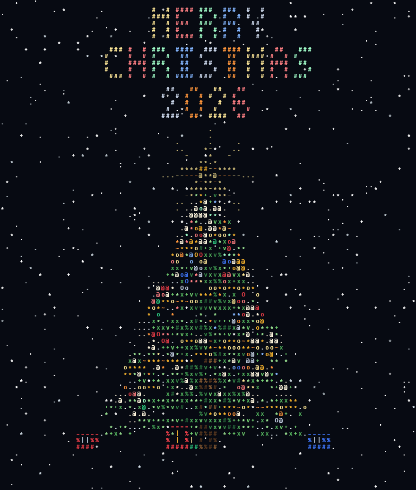

# ASCII Christmas Tree

A rotating 3D Christmas tree drawn entirely with colored ASCII characters, rendered in
real time with Python and [pygame-ce](https://pyga.me/). Snow falls in front of and
behind the tree, a star lights up at the top, and a pixel-art greeting builds itself
letter by letter.



## What you get

- A procedural spruce built from ~11,400 particles: needles, trunk, garland, baubles,
  fairy lights, gift boxes, and a star topper.
- Real 3D: the tree rotates on the Y axis with perspective projection, a per-cell
  z-buffer, and depth shading, so nearer branches are brighter and correctly cover
  farther ones.
- A timeline instead of a static scene: the trunk appears first, then branches grow,
  the garland wraps around, ornaments and lights switch on, gifts drop in, the star
  flashes, and the greeting types itself out.
- Two layers of falling snow, twinkling background stars, and a bitmap banner that
  spells **MERRY CHRISTMAS 2026**.
- Locked 30 FPS, an 88 × 74 character grid, and no external assets beyond the bundled
  monospace font.

## Three ways to share it

The same tree ships in three forms, so you can pick whichever fits the moment.

| Form | File | Works offline | How to send it |
|---|---|---|---|
| Shareable link | `index.html` + `dist/` | No | Post the GitHub Pages URL |
| Single HTML file | `dist/ascii-christmas-tree.html` | **Yes** | WhatsApp → Document |
| Tree-shaped QR code | `docs/qr-tree.png` | No | Send as a photo, they scan it |

### Shareable link

The repository is ready to publish as a static site. `index.html` carries the
Open Graph tags that make a link preview show the tree instead of a bare URL,
then redirects straight to the single-file build.

```
Repository → Settings → Pages
Source : Deploy from a branch
Branch : main
Folder : / (root)
```

The site lands at `https://oxslash.github.io/ascii-christmas-tree/`. Four preview
cards are included at 1200 × 630, and the mobile layout crops only empty sky so
the banner stays readable on a phone. See [docs/SHARING.md](docs/SHARING.md).

### Single HTML file

One self-contained file, ~578 KB. No server, no internet, no Python. Open it and
the tree runs. Built with:

```bash
python tools/build_single_file.py
```

See [docs/SINGLE_FILE.md](docs/SINGLE_FILE.md).

### Tree-shaped QR code

A QR code whose modules themselves form a Christmas tree, so the thing you scan
and the thing you see are the same object. Error correction level H leaves room
for the artwork without breaking the code. Built with:

```bash
python tools/make_qr.py --url "https://your-site.vercel.app"
```

Verified to still decode after JPEG quality 40 and downscaling to 30% of its size.


## Controls

| Key | Action |
| --- | --- |
| `Space` | Pause / resume |
| `R` | Restart the animation |
| `S` | Save a screenshot (desktop build only) |
| `D` | Toggle debug readouts |
| `Esc` | Quit |

In the HTML file, tap or click the canvas to pause instead.

## Run it on your computer

Python 3.12 or newer is required.

```bash
python -m venv .venv
.venv\Scripts\activate
pip install -r requirements.txt
python web/main.py
```

On macOS or Linux use `source .venv/bin/activate` instead. Optional flags:

```bash
python web/main.py --seed 8412 --fps 60
```

`--seed` changes the random layout (the same seed always produces the same tree), and
`--fps` changes the frame cap. Both flags are ignored in the browser build.

## Run it in the browser

The web version is built with [pygbag](https://pygame-web.github.io/), which compiles
the Python source to WebAssembly.

```bash
python tools/build_web.py
```

The script runs pygbag and copies the generated site into `public/`. Serve it locally
with:

```bash
python -m http.server 8000 --directory public
```

Then open <http://localhost:8000>. See [docs/DEPLOY.md](docs/DEPLOY.md) for publishing
to GitHub and Vercel.

## Project layout

```
web/main.py                    the entire program
web/FiraMono-Regular.ttf       bundled monospace font
web/OFL.txt                    SIL Open Font License for the font

index.html                     GitHub Pages landing page with Open Graph tags
.nojekyll                      serve files as-is on GitHub Pages

tools/build_web.py             pygbag build + copy into public/
tools/build_single_file.py     build the offline HTML file
tools/make_qr.py               build the tree-shaped QR code
tools/make_social_cards.py     build the four 1200x630 preview cards

tools/browser_probe.py         headless Edge/Chrome driver, kills only its own process
tools/check_index.py           load index.html, confirm the redirect lands on the tree
tools/check_mobile.py          load the tree at three phone viewports, screenshot each
tools/check_single_file.py     load the tree on desktop, report view size and FPS
tools/bench_single_file.py     measure FPS three times, take the median
tools/dump_native_frame.py     dump the pygame framebuffer to JSON
tools/compare_frames.py        compare web frame against native frame
tools/check_qr.py              decode the QR after compression and downscaling

public/                        ready-to-deploy browser build
dist/                          offline HTML file
docs/                          preview, preview cards, QR, deploy and sharing guides
```

The `check_*` scripts and `compare_frames.py` exist to prove the claims above
rather than assume them. They drive a headless browser through the DevTools
protocol and terminate only the process they started, so a browser you are using
is never touched.

## How it works

Every frame the particle cloud is rotated, projected with a pinhole camera, and
splatted into a character grid. Each cell keeps the smallest depth seen so far, which
acts as a z-buffer; only the winning particle contributes its glyph, color, and
brightness level. Glyphs are rendered once per (character, color, level) combination
into a texture atlas and blitted to the screen, which keeps the frame time low even
with thousands of particles.

Measured on the development machine:

| Build | Frame rate |
|---|---|
| Desktop (pygame-ce, SDL) | 310 FPS |
| Browser (pygbag / WebAssembly) | 30.4 FPS |
| Offline HTML (JavaScript, desktop) | 48.4 FPS |
| Offline HTML (JavaScript, phone viewport) | 36.0 FPS |

The offline HTML build reaches 99.91% glyph agreement with the pygame build at the
same timestamp; the remaining cells are sub-pixel tie-breaks that are not visible.

## License

MIT. See [LICENSE](LICENSE). The bundled Fira Mono font is under the SIL Open Font
License, see [web/OFL.txt](web/OFL.txt).
